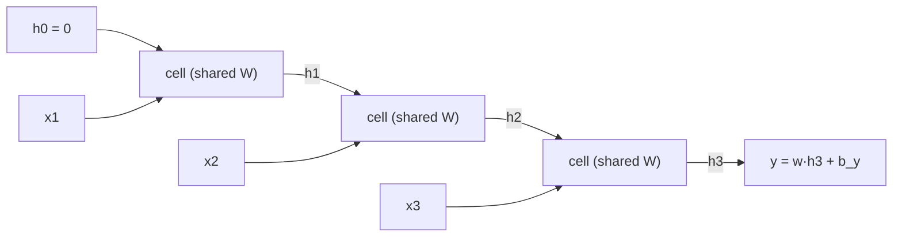

## Objectifs d'apprentissage

- Écrire la récurrence d'un RNN simple (vanilla), le dessiner déplié, et donner la forme de chaque tenseur.
- Dériver pas à pas la rétropropagation à travers le temps (BPTT) et expliquer pourquoi les poids partagés accumulent des gradients.
- Montrer avec le produit de jacobiennes pourquoi les gradients s'évanouissent ou explosent et relier cela au rayon spectral de $W_{hh}$.
- Appliquer l'écrêtage du gradient et expliquer la BPTT tronquée.
- Implémenter la passe avant et la BPTT d'une régression plusieurs-vers-un et la vérifier par gradient numérique.

## Prérequis

La rétropropagation avec les dimensions ([[f2n.10]]), la règle de la chaîne multivariée et les jacobiennes, les valeurs propres et les valeurs singulières, et les vecteurs de mots comme entrées ([[seq.02]]).

## Où cela s'inscrit

Le texte, la parole, les flux de capteurs, les cours de bourse et les fichiers de journaux sont des **séquences de longueur variable** où l'ordre compte : « dog bites man » n'est pas « man bites dog ». Un perceptron multicouche a un nombre fixe d'entrées (diapositives du CNAM, p. 5) : soit on découpe le texte en une fenêtre fixe et on agrège grossièrement, soit on prend une fenêtre énorme et on en paie le prix. Une convolution ([[seq.01]]) ne voit qu'une petite fenêtre.

Un réseau **récurrent** lit la séquence un élément à la fois et porte une mémoire. Le même petit réseau est réutilisé à chaque pas, donc il gère n'importe quelle longueur avec un nombre fixe de paramètres. Les tâches qu'il sert (d'après les diapositives du cours) : la *classification* (séquence vers une étiquette : spam, sentiment), l'*annotation* (une étiquette par élément : étiquettes grammaticales, entités) et la *réécriture* (séquence vers une autre séquence : traduction, traitée dans [[seq.05]]).

## L'idée en mots simples

Imagine lire une phrase en gardant un seul pense-bête. Pour chaque nouveau mot, tu regardes le mot et ton pense-bête, puis tu réécris le pense-bête : « jusqu'ici : un oiseau est mentionné, il a été cité par Pline ». Le pense-bête a une taille fixe, donc tu dois décider quoi garder. La règle de réécriture est la même à chaque mot. À la fin, tu réponds à une question en utilisant le pense-bête final.

Ce pense-bête est l'**état caché** $h_t$. La règle de réécriture est une petite couche neuronale. Entraîner, c'est ajuster la règle pour que le pense-bête final (ou chaque pense-bête intermédiaire) soutienne la bonne réponse.

L'apprentissage a un hic. Le gradient de la perte par rapport à un mot ancien doit remonter à travers chaque étape de réécriture. Si chaque étape le multiplie par quelque chose d'un peu inférieur à 1, il s'évanouit après quelques dizaines de mots ; un peu supérieur à 1 et il explose. C'est le problème central des deux prochaines leçons.

## Définition formelle

Séquence $x_1,\dots,x_T$ avec $x_t\in\mathbb{R}^{n}$ (par exemple des plongements de mots). Taille cachée $H$.

$$
a_t=W_{xh}x_t+W_{hh}h_{t-1}+b,\qquad h_t=\tanh(a_t),\qquad h_0=0 .
$$

| Symbole | Dimensions |
|---|---|
| $x_t$ | $(n)$, par batch : $(B,n)$ |
| $W_{xh}$ | $(H,n)$ |
| $W_{hh}$ | $(H,H)$ |
| $b$ | $(H)$ |
| $h_t,a_t$ | $(H)$, par batch : $(B,H)$ |

(En code par batch avec les échantillons en lignes : `a = X_t @ Wxh.T + h_prev @ Whh.T + b`.) Les diapositives du CNAM écrivent la même chose $z_i=W_xx_i+W_hh_{i-1}$, $h_i=\sigma(z_i)$, $y_i=W_yh_i$.

**Dépliage.** Dessine une copie de la cellule par pas de temps, en passant $h_t$ à la suivante. Le réseau déplié est un réseau feed-forward ordinaire de profondeur $T$ dont les couches **partagent les mêmes poids** (diapositives, p. 12). On peut donc l'entraîner par rétropropagation ordinaire, et plus la séquence est longue, plus le réseau est profond.



**Têtes de sortie.** Annotation : un classifieur sur chaque $h_t$ et une perte sommée sur $t$. Classification ou régression : n'utiliser que le dernier état, $\hat y=w_y^\top h_T+b_y$, qui est le cas que nous dérivons. (La bibliothèque source note que pour la classification, un max-pooling sur tous les $h_t$ bat souvent le dernier état ; nous n'en avons pas besoin ici.)

## Dérivation : la rétropropagation à travers le temps

Régression plusieurs-vers-un avec un batch de taille $B$ : $\hat y_b=w_y^\top h_T^{(b)}+b_y$ et $L=\frac1{2B}\sum_b(\hat y_b-y_b)^2$. Notation barre : $\bar Q=\partial L/\partial Q$, de même forme que $Q$. Par exemple (on laisse tomber l'indice de batch, on le remet à la fin) :

**Couche de sortie.** $\bar{\hat y}=(\hat y-y)/B$. Puis $\bar w_y=\sum_b\bar{\hat y}_b\,h_T^{(b)}$, $\bar b_y=\sum_b\bar{\hat y}_b$ et le gradient qui entre dans la récurrence est

$$
\bar h_T=\bar{\hat y}\;w_y\qquad(H).
$$

**Un pas en arrière.** Supposons que l'on connaisse $\bar h_t$, le gradient total de $L$ par rapport à l'état au temps $t$. Comme $h_t=\tanh(a_t)$ terme à terme, $\bar a_t=\bar h_t\odot(1-h_t^2)$. Comme $a_t=W_{xh}x_t+W_{hh}h_{t-1}+b$ est une couche linéaire, on lit (comme dans [[f2n.10]]) :

$$
\bar a_t=\bar h_t\odot(1-h_t^{2}),\qquad
\bar h_{t-1}\mathrel{+}=W_{hh}^\top\bar a_t,\qquad
\bar W_{xh}\mathrel{+}=\bar a_t\,x_t^\top,\quad
\bar W_{hh}\mathrel{+}=\bar a_t\,h_{t-1}^\top,\quad
\bar b\mathrel{+}=\bar a_t .
$$

Dimensions : $\bar a_tx_t^\top:(H)(n)^\top=(H,n)$, $\bar a_th_{t-1}^\top:(H,H)$, $W_{hh}^\top\bar a_t:(H)$. Le « $+=$ » est le point crucial : **le même $W_{hh}$ est utilisé à chaque pas**, donc par la règle de la chaîne sur un paramètre partagé son gradient est la **somme** des contributions des $T$ pas. Le gradient d'entrée pour $x_t$ (si nécessaire) est $W_{xh}^\top\bar a_t$.

Parcours $t=T,T-1,\dots,1$. La seule quantité transmise vers l'arrière est $\bar h$. Mets en cache chaque $h_t$ lors de la passe avant ; la mémoire croît linéairement avec $T$.

**Forme par batch** (les lignes sont les échantillons ; `dh` a la forme $(B,H)$) :

```python
da = dh * (1 - h[t] ** 2)           # (B, H)
dWxh += da.T @ X[:, t-1]            # (H, B)(B, n) = (H, n)
dWhh += da.T @ h[t-1]               # (H, H)
db   += da.sum(axis=0)              # (H,)
dh = da @ Whh                       # (B, H), passed to step t-1
```

## Exemple détaillé (un RNN scalaire, deux pas)

$n=H=1$, $w_{xh}=0.5$, $w_{hh}=0.8$, $b=0$, $w_y=2$, $b_y=0$ ; entrée $x=(1,-1)$, cible $y=0.5$, $B=1$.

Passe avant :

- $h_1=\tanh(0.5\cdot1)=0.46212$
- $h_2=\tanh(0.5\cdot(-1)+0.8\cdot0.46212)=\tanh(-0.13031)=-0.12957$
- $\hat y=2h_2=-0.25915$, $L=\tfrac12(-0.25915-0.5)^2=0.28815$

Passe arrière :

- $\bar{\hat y}=-0.75915$ ; $\bar w_y=h_2\bar{\hat y}=0.09837$ ; $\bar b_y=-0.75915$
- $\bar h_2=\bar{\hat y}\,w_y=-1.51829$
- $\bar a_2=\bar h_2(1-h_2^2)=-1.51829\cdot0.98321=-1.49280$
- $\bar h_1=w_{hh}\bar a_2=-1.19424$ ; $\bar a_1=\bar h_1(1-h_1^2)=-1.19424\cdot0.78645=-0.93923$
- $\bar w_{xh}=\bar a_1x_1+\bar a_2x_2=-0.93923+1.49280=0.55357$
- $\bar w_{hh}=\bar a_2h_1+\bar a_1h_0=-1.49280\cdot0.46212+0=-0.68985$
- $\bar b=\bar a_1+\bar a_2=-2.43203$

Le code de l'exercice renvoie $0.55359,\ -0.68985,\ -2.43201$ (mes arrondis à la main diffèrent au dernier chiffre). Remarque comment $\bar w_{xh}$ et $\bar b$ additionnent des contributions des deux pas.

## Pourquoi les gradients s'évanouissent ou explosent

Le gradient qui atteint un état ancien est un **produit de jacobiennes**. À partir de $h_t=\tanh(W_{xh}x_t+W_{hh}h_{t-1}+b)$ :

$$
J_t:=\frac{\partial h_t}{\partial h_{t-1}}=\operatorname{diag}\big(1-h_t^2\big)\,W_{hh}\qquad(H\times H),
$$

et par la règle de la chaîne

$$
\frac{\partial h_T}{\partial h_0}=J_T J_{T-1}\cdots J_1 .
$$

C'est la formule des diapositives du CNAM $\prod\operatorname{diag}(\sigma'(z_i))\,W_h$ (p. 17). En prenant les normes, qui sont sous-multiplicatives ($\lVert AB\rVert\le\lVert A\rVert\lVert B\rVert$, diapositive p. 18) :

$$
\Big\lVert\frac{\partial h_T}{\partial h_0}\Big\rVert\le\prod_{t=1}^{T}\lVert\operatorname{diag}(1-h_t^2)\rVert\,\lVert W_{hh}\rVert\le\lVert W_{hh}\rVert^{T}
$$

car $0<1-h^2\le1$. Donc si $\lVert W_{hh}\rVert<1$, le gradient venant de $T$ pas en arrière **diminue au moins géométriquement**. C'est une borne pour l'évanouissement. Pour l'explosion, et pour une image plus fine, regarde le cas linéaire (dérivée de l'activation $\approx1$, p. ex. petits états) où le produit vaut exactement $W_{hh}^{T}$. Sa taille est gouvernée par le **rayon spectral** $\rho(W_{hh})=\max_i|\lambda_i|$ : pour $T$ grand, $\lVert W_{hh}^T\rVert\approx c\,\rho^T$ (à une constante près, et avec un régime transitoire pour les matrices non normales). Avec $\rho<1$ le gradient s'évanouit, avec $\rho>1$ il explose en général, et $\rho=1$ est le fil du rasoir. Dans l'exemple jouet de la bibliothèque source, un poids récurrent de $0.9$ sur 100 pas donne $0.9^{100}\approx2.7\times10^{-5}$.

**Nombres** (du second exercice, $H=16$, $W_{hh}$ aléatoire remise à l'échelle au $\rho$ donné ; $\lVert\cdot\rVert$ est la plus grande valeur singulière de $\partial h_T/\partial h_0$) :

| $\rho$ | linéaire, $T=10$ | linéaire, $T=50$ | tanh, $T=10$ | tanh, $T=50$ |
|---|---|---|---|---|
| 0.5 | $1.3\times10^{-3}$ | $1.1\times10^{-15}$ | $1.2\times10^{-3}$ | $6.8\times10^{-16}$ |
| 0.9 | $0.45$ | $6.6\times10^{-3}$ | $0.40$ | $2.4\times10^{-3}$ |
| 1.0 | $1.28$ | $1.28$ | $1.11$ | $0.32$ |
| 1.5 | $74$ | $8.2\times10^{8}$ | $33$ | $0.033$ |

Deux leçons. D'abord, la colonne linéaire suit $\rho^T$ (compare $0.5^{50}=8.9\times10^{-16}$, $1.5^{50}=6.4\times10^8$). Ensuite, avec tanh l'explosion est **domptée par la saturation** : de grands états poussent $h_t$ vers $\pm1$, où $1-h_t^2\approx0$, si bien que le même grand $W_{hh}$ qui explose dans le cas linéaire finit par tuer le gradient à longue portée (dernière colonne, $\rho=1.5$). Les gradients explosifs se produisent quand même en pratique, typiquement sous forme de pas occasionnels gigantesques, c'est pourquoi on écrête.

**Conséquence.** L'influence du mot 2 sur la perte au mot 100 est effectivement nulle : le réseau ne peut pas *apprendre* de dépendances à longue portée (l'oiseau de l'exemple des diapositives est mentionné au début, la classe est décidée à la fin), même s'il peut en principe les *représenter*. Le remède est architectural ([[seq.04]]).

### Écrêtage du gradient et BPTT tronquée

Contre l'explosion, les diapositives nomment le remède standard, l'**écrêtage** (clipping). En utilisant la norme globale de tous les gradients $g$ :

$$
g\leftarrow g\cdot\min\!\Big(1,\frac{\tau}{\lVert g\rVert}\Big).
$$

La direction est préservée ; seule la longueur du pas est plafonnée. Il traite les gradients explosifs mais ne fait rien contre ceux qui s'évanouissent. La **BPTT tronquée** coupe la passe arrière après $k$ pas (et traite $h$ comme une constante en avançant) pour borner la mémoire et le calcul, au prix d'ignorer les dépendances plus longues que $k$. Un autre levier bon marché est l'initialisation : un $W_{hh}$ orthogonal a toutes ses valeurs singulières égales à 1, donc le produit *linéaire* garde exactement la norme 1 (vérifié dans l'exercice), même si la saturation de tanh et l'entraînement l'en éloigneront.

## Implémentation

```python
import numpy as np

def rnn_loss_grads(params, X, y):
    Wxh, Whh, b, Wy, by = params          # (H,n) (H,H) (H,) (H,) ()
    B, T, n = X.shape
    hs = [np.zeros((B, Whh.shape[0]))]
    for t in range(T):
        hs.append(np.tanh(X[:, t] @ Wxh.T + hs[-1] @ Whh.T + b))
    yhat = hs[-1] @ Wy + by
    loss = 0.5 * np.mean((yhat - y) ** 2)
    dy = (yhat - y) / B
    dWy, dby = hs[-1].T @ dy, dy.sum()
    dh = np.outer(dy, Wy)
    dWxh, dWhh, db = np.zeros_like(Wxh), np.zeros_like(Whh), np.zeros_like(b)
    for t in range(T, 0, -1):
        da = dh * (1 - hs[t] ** 2)
        dWxh += da.T @ X[:, t - 1]
        dWhh += da.T @ hs[t - 1]
        db += da.sum(axis=0)
        dh = da @ Whh
    return loss, (dWxh, dWhh, db, dWy, dby)
```

Dans le premier exercice, ceci passe une vérification par différences centrées avec une erreur relative d'environ $10^{-9}$ sur un petit réseau ($B=4,T=6,n=3,H=5$). Si $\bar W_{hh}$ est faux alors que $\bar W_y$ est juste, tu as probablement oublié d'accumuler sur le temps ou utilisé $h_t$ au lieu de $h_{t-1}$.

## Idées reçues

- **« Un RNN a une matrice de poids par pas de temps. »** Un seul jeu de poids, réutilisé ; c'est pourquoi les gradients sont des sommes sur le temps.
- **« La BPTT est un algorithme différent. »** C'est la rétropropagation ordinaire sur le graphe déplié.
- **« Les gradients explosifs sont les mêmes que les gradients évanescents avec le signe inversé. »** L'écrêtage règle les explosions, pas l'évanouissement ; et avec la saturation de tanh, un grand $\rho$ peut mener à l'évanouissement à longue portée.
- **« Le rayon spectral décide de tout. »** Il décide du comportement *linéaire*. Le produit réel contient aussi $\operatorname{diag}(1-h^2)$ et, pour les matrices non normales, une croissance transitoire avant que l'asymptotique s'installe. Traite $\rho$ comme un indicateur, pas comme une loi exacte.
- **« Des gradients évanescents signifient que le RNN oublie l'entrée. »** Le signal avant peut être présent dans $h_T$ ; c'est le *signal d'apprentissage* qui ne peut pas atteindre les premiers pas.

## Limites et compromis

- Séquentiel : le pas $t$ a besoin du pas $t-1$, donc l'entraînement ne peut pas se paralléliser sur le temps (la bibliothèque source en fait un goulot d'étranglement), contrairement aux convolutions ou à l'attention.
- Un état de taille fixe compresse tout l'historique : les longues entrées perdent du détail.
- Les dépendances à longue portée sont difficiles à apprendre (cette leçon) ; les portes ([[seq.04]]) et l'attention ([[seq.05]]) sont les deux grandes réponses.
- Empiler 2-3 couches récurrentes est courant (diapositives) ; davantage aide rarement.

## Points clés

- $h_t=\tanh(W_{xh}x_t+W_{hh}h_{t-1}+b)$, poids partagés sur le temps ; déplié, c'est un réseau profond de profondeur $T$.
- BPTT : $\bar a_t=\bar h_t\odot(1-h_t^2)$ ; $\bar h_{t-1}=W_{hh}^\top\bar a_t$ ; les gradients des poids partagés sont des **sommes sur $t$**.
- $\partial h_T/\partial h_0=\prod_tJ_t$ avec $J_t=\operatorname{diag}(1-h_t^2)W_{hh}$ ; sa norme se comporte comme $\rho(W_{hh})^T$ en régime linéaire : s'évanouit sous 1, explose au-dessus de 1.
- Écrête la norme globale du gradient contre les explosions ; utilise la BPTT tronquée pour limiter le coût ; aucune ne guérit l'évanouissement.

## Explique-le toi-même

1. Dérive $\bar W_{hh}$ pour un RNN à 3 pas et montre que c'est une somme de trois produits extérieurs. Quels termes s'évanouissent si $W_{hh}$ a une norme $<1$ ?
2. Pourquoi un grand rayon spectral peut-il quand même produire un gradient évanescent dans un RNN tanh ?

## Pour aller plus loin

- Diapositives CNAM RCP217 `cours-tal-02.pdf`, p. 3-25 du PDF.
- Bibliothèque source : `ai-engineering-from-scratch` phase 05 leçon 08 (CNN et RNN pour le texte).
- Ensuite : [[seq.04]], le chemin de mémoire additif qui répare le gradient.

## Critères de maîtrise

Tu sais dériver la BPTT du RNN plusieurs-vers-un à partir des équations de la passe avant avec les dimensions, ton implémentation NumPy passe une vérification de gradient, et tu sais expliquer à partir du produit de jacobiennes pourquoi le gradient varie comme $\rho(W_{hh})^T$ en régime linéaire.
