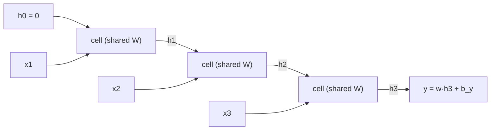

## Learning objectives

- Write the recurrence of a vanilla RNN, draw it unrolled, and give the shape of every tensor.
- Derive backpropagation through time (BPTT) step by step and explain why shared weights accumulate gradients.
- Show with the Jacobian product why gradients vanish or explode and relate this to the spectral radius of $W_{hh}$.
- Apply gradient clipping and explain truncated BPTT.
- Implement forward and BPTT for a many-to-one regression and gradient-check it.

## Prerequisites

Backprop with shapes ([[f2n.10]]), the multivariate chain rule and Jacobians, eigenvalues and singular values, and word vectors as inputs ([[seq.02]]).

## Where this fits

Text, speech, sensor streams, stock prices and log files are **sequences of variable length** in which order matters: "dog bites man" is not "man bites dog". A multilayer perceptron has a fixed number of inputs (CNAM slides, p.5): either you cut the text into a fixed window and aggregate crudely, or you take a huge window and pay for it. A convolution ([[seq.01]]) sees only a small window.

A **recurrent** network reads the sequence one element at a time and carries a memory. The same small network is reused at every step, so it handles any length with a fixed number of parameters. Tasks it serves (from the course slides): *classification* (sequence to one label: spam, sentiment), *annotation* (a label per element: part-of-speech tags, entities) and *rewriting* (sequence to a different sequence: translation, covered in [[seq.05]]).

## The idea in plain words

Picture reading a sentence while keeping a single sticky note. For each new word you look at the word and at your note, then rewrite the note: "so far: a bird is mentioned, it was cited by Pliny". The note has a fixed size, so you must decide what to keep. The rule for rewriting the note is the same at every word. At the end, you answer a question using the final note.

That note is the **hidden state** $h_t$. The rewriting rule is a small neural layer. Training means adjusting the rule so that the final note (or each intermediate note) supports the right answer.

Learning has a catch. The gradient of the loss with respect to an early word must travel back through every rewriting step. If each step multiplies it by something slightly below 1 it fades to nothing after a few dozen words; slightly above 1 and it blows up. This is the central problem of the next two lessons.

## Formal definition

Sequence $x_1,\dots,x_T$ with $x_t\in\mathbb{R}^{n}$ (for instance word embeddings). Hidden size $H$.

$$
a_t=W_{xh}x_t+W_{hh}h_{t-1}+b,\qquad h_t=\tanh(a_t),\qquad h_0=0 .
$$

| Symbol | Shape |
|---|---|
| $x_t$ | $(n)$, batched: $(B,n)$ |
| $W_{xh}$ | $(H,n)$ |
| $W_{hh}$ | $(H,H)$ |
| $b$ | $(H)$ |
| $h_t,a_t$ | $(H)$, batched: $(B,H)$ |

(In batched code with rows as samples: `a = X_t @ Wxh.T + h_prev @ Whh.T + b`.) The CNAM slides write the same thing as $z_i=W_xx_i+W_hh_{i-1}$, $h_i=\sigma(z_i)$, $y_i=W_yh_i$.

**Unrolling.** Draw one copy of the cell per time step, passing $h_t$ to the next. The unrolled network is an ordinary feed-forward network of depth $T$ whose layers **share the same weights** (slides, p.12). So we can train it by ordinary backpropagation, and the longer the sequence, the deeper the network.



**Output heads.** Annotation: a classifier on every $h_t$ and a loss summed over $t$. Classification or regression: use only the last state, $\hat y=w_y^\top h_T+b_y$, which is the case we derive. (The source library notes that for classification, max-pooling over all $h_t$ often beats the last state; we do not need that here.)

## Derivation: backpropagation through time

Many-to-one regression with batch size $B$: $\hat y_b=w_y^\top h_T^{(b)}+b_y$ and $L=\frac1{2B}\sum_b(\hat y_b-y_b)^2$. Bar notation: $\bar Q=\partial L/\partial Q$, same shape as $Q$. Per example (drop the batch index, add it back at the end):

**Output layer.** $\bar{\hat y}=(\hat y-y)/B$. Then $\bar w_y=\sum_b\bar{\hat y}_b\,h_T^{(b)}$, $\bar b_y=\sum_b\bar{\hat y}_b$ and the gradient entering the recurrence is

$$
\bar h_T=\bar{\hat y}\;w_y\qquad(H).
$$

**One step backwards.** Suppose we know $\bar h_t$, the total gradient of $L$ with respect to the state at time $t$. Since $h_t=\tanh(a_t)$ elementwise, $\bar a_t=\bar h_t\odot(1-h_t^2)$. Because $a_t=W_{xh}x_t+W_{hh}h_{t-1}+b$ is a linear layer, we read off (as in [[f2n.10]]):

$$
\bar a_t=\bar h_t\odot(1-h_t^{2}),\qquad
\bar h_{t-1}\mathrel{+}=W_{hh}^\top\bar a_t,\qquad
\bar W_{xh}\mathrel{+}=\bar a_t\,x_t^\top,\quad
\bar W_{hh}\mathrel{+}=\bar a_t\,h_{t-1}^\top,\quad
\bar b\mathrel{+}=\bar a_t .
$$

Shapes: $\bar a_tx_t^\top:(H)(n)^\top=(H,n)$, $\bar a_th_{t-1}^\top:(H,H)$, $W_{hh}^\top\bar a_t:(H)$. The "$+=$" is the crux: **the same $W_{hh}$ is used at every step**, so by the chain rule over a shared parameter its gradient is the **sum** of the contributions of all $T$ steps. The input gradient for $x_t$ (if needed) is $W_{xh}^\top\bar a_t$.

Run $t=T,T-1,\dots,1$. The only quantity passed backwards is $\bar h$. Cache every $h_t$ in the forward pass; memory grows linearly with $T$.

**Batched form** (rows are samples; `dh` has shape $(B,H)$):

```python
da = dh * (1 - h[t] ** 2)           # (B, H)
dWxh += da.T @ X[:, t-1]            # (H, B)(B, n) = (H, n)
dWhh += da.T @ h[t-1]               # (H, H)
db   += da.sum(axis=0)              # (H,)
dh = da @ Whh                       # (B, H), passed to step t-1
```

## Worked example (one scalar RNN, two steps)

$n=H=1$, $w_{xh}=0.5$, $w_{hh}=0.8$, $b=0$, $w_y=2$, $b_y=0$; input $x=(1,-1)$, target $y=0.5$, $B=1$.

Forward:

- $h_1=\tanh(0.5\cdot1)=0.46212$
- $h_2=\tanh(0.5\cdot(-1)+0.8\cdot0.46212)=\tanh(-0.13031)=-0.12957$
- $\hat y=2h_2=-0.25915$, $L=\tfrac12(-0.25915-0.5)^2=0.28815$

Backward:

- $\bar{\hat y}=-0.75915$; $\bar w_y=h_2\bar{\hat y}=0.09837$; $\bar b_y=-0.75915$
- $\bar h_2=\bar{\hat y}\,w_y=-1.51829$
- $\bar a_2=\bar h_2(1-h_2^2)=-1.51829\cdot0.98321=-1.49280$
- $\bar h_1=w_{hh}\bar a_2=-1.19424$; $\bar a_1=\bar h_1(1-h_1^2)=-1.19424\cdot0.78645=-0.93923$
- $\bar w_{xh}=\bar a_1x_1+\bar a_2x_2=-0.93923+1.49280=0.55357$
- $\bar w_{hh}=\bar a_2h_1+\bar a_1h_0=-1.49280\cdot0.46212+0=-0.68985$
- $\bar b=\bar a_1+\bar a_2=-2.43203$

The exercise code returns $0.55359,\ -0.68985,\ -2.43201$ (my hand rounding differs in the last digit). Note how $\bar w_{xh}$ and $\bar b$ add contributions from both steps.

## Why gradients vanish or explode

The gradient reaching an early state is a **product of Jacobians**. From $h_t=\tanh(W_{xh}x_t+W_{hh}h_{t-1}+b)$:

$$
J_t:=\frac{\partial h_t}{\partial h_{t-1}}=\operatorname{diag}\big(1-h_t^2\big)\,W_{hh}\qquad(H\times H),
$$

and by the chain rule

$$
\frac{\partial h_T}{\partial h_0}=J_T J_{T-1}\cdots J_1 .
$$

This is the CNAM slides' formula $\prod\operatorname{diag}(\sigma'(z_i))\,W_h$ (p.17). Taking norms, which are sub-multiplicative ($\lVert AB\rVert\le\lVert A\rVert\lVert B\rVert$, slide p.18):

$$
\Big\lVert\frac{\partial h_T}{\partial h_0}\Big\rVert\le\prod_{t=1}^{T}\lVert\operatorname{diag}(1-h_t^2)\rVert\,\lVert W_{hh}\rVert\le\lVert W_{hh}\rVert^{T}
$$

because $0<1-h^2\le1$. So if $\lVert W_{hh}\rVert<1$ the gradient from $T$ steps back **shrinks at least geometrically**. This is a bound for vanishing. For exploding, and for a sharper picture, look at the linear case (activation derivative $\approx1$, e.g. small states) where the product is exactly $W_{hh}^{T}$. Its size is governed by the **spectral radius** $\rho(W_{hh})=\max_i|\lambda_i|$: for large $T$, $\lVert W_{hh}^T\rVert\approx c\,\rho^T$ (up to a constant, and some transient for non-normal matrices). With $\rho<1$ the gradient vanishes, with $\rho>1$ it generically explodes, and $\rho=1$ is the knife edge. In the source library's toy example, a recurrent weight of $0.9$ over 100 steps gives $0.9^{100}\approx2.7\times10^{-5}$.

**Numbers** (from the second exercise, $H=16$, random $W_{hh}$ rescaled to the given $\rho$; $\lVert\cdot\rVert$ is the largest singular value of $\partial h_T/\partial h_0$):

| $\rho$ | linear, $T=10$ | linear, $T=50$ | tanh, $T=10$ | tanh, $T=50$ |
|---|---|---|---|---|
| 0.5 | $1.3\times10^{-3}$ | $1.1\times10^{-15}$ | $1.2\times10^{-3}$ | $6.8\times10^{-16}$ |
| 0.9 | $0.45$ | $6.6\times10^{-3}$ | $0.40$ | $2.4\times10^{-3}$ |
| 1.0 | $1.28$ | $1.28$ | $1.11$ | $0.32$ |
| 1.5 | $74$ | $8.2\times10^{8}$ | $33$ | $0.033$ |

Two lessons. First, the linear column tracks $\rho^T$ (compare $0.5^{50}=8.9\times10^{-16}$, $1.5^{50}=6.4\times10^8$). Second, with tanh the explosion is **tamed by saturation**: large states push $h_t$ towards $\pm1$, where $1-h_t^2\approx0$, so the same large $W_{hh}$ that explodes in the linear case ends up killing the gradient at long range (last column, $\rho=1.5$). Exploding gradients do still occur in practice, typically as occasional huge steps, which is why we clip.

**Consequence.** The influence of word 2 on the loss at word 100 is effectively zero: the network cannot *learn* long-range dependencies (the bird in the slides' example is mentioned at the start, the class is decided at the end), even though it can in principle *represent* them. The fix is architectural ([[seq.04]]).

### Gradient clipping and truncated BPTT

Against explosion the slides name the standard remedy, **clipping**. Using the global norm of all gradients $g$:

$$
g\leftarrow g\cdot\min\!\Big(1,\frac{\tau}{\lVert g\rVert}\Big).
$$

The direction is preserved; only the step length is capped. It treats exploding gradients but does nothing for vanishing ones. **Truncated BPTT** cuts the backward pass after $k$ steps (and keeps $h$ as a constant going forward) to bound memory and compute, at the price of ignoring dependencies longer than $k$. Another cheap lever is initialisation: an orthogonal $W_{hh}$ has all singular values equal to 1, so the *linear* product keeps norm exactly 1 (checked in the exercise), though tanh saturation and training will move it away.

## Implementation

```python
import numpy as np

def rnn_loss_grads(params, X, y):
    Wxh, Whh, b, Wy, by = params          # (H,n) (H,H) (H,) (H,) ()
    B, T, n = X.shape
    hs = [np.zeros((B, Whh.shape[0]))]
    for t in range(T):
        hs.append(np.tanh(X[:, t] @ Wxh.T + hs[-1] @ Whh.T + b))
    yhat = hs[-1] @ Wy + by
    loss = 0.5 * np.mean((yhat - y) ** 2)
    dy = (yhat - y) / B
    dWy, dby = hs[-1].T @ dy, dy.sum()
    dh = np.outer(dy, Wy)
    dWxh, dWhh, db = np.zeros_like(Wxh), np.zeros_like(Whh), np.zeros_like(b)
    for t in range(T, 0, -1):
        da = dh * (1 - hs[t] ** 2)
        dWxh += da.T @ X[:, t - 1]
        dWhh += da.T @ hs[t - 1]
        db += da.sum(axis=0)
        dh = da @ Whh
    return loss, (dWxh, dWhh, db, dWy, dby)
```

In the first exercise this passes a central-difference check with relative error around $10^{-9}$ on a small network ($B=4,T=6,n=3,H=5$). If $\bar W_{hh}$ is wrong while $\bar W_y$ is right, you probably forgot to accumulate over time or used $h_t$ instead of $h_{t-1}$.

## Common misconceptions

- **"An RNN has one weight matrix per time step."** One set of weights, reused; that is why gradients are sums over time.
- **"BPTT is a different algorithm."** It is ordinary backpropagation on the unrolled graph.
- **"Exploding gradients are the same as vanishing gradients with the sign flipped."** Clipping fixes explosions, not vanishing; and with tanh saturation, a large $\rho$ can lead to vanishing at long range.
- **"The spectral radius decides everything."** It decides the *linear* behaviour. The actual product also contains $\operatorname{diag}(1-h^2)$ and, for non-normal matrices, transient growth before the asymptotics set in. Treat $\rho$ as an indicator, not an exact law.
- **"Vanishing gradients mean the RNN forgets the input."** The forward signal may be present in $h_T$; it is the *learning signal* that cannot reach early steps.

## Limits and trade-offs

- Sequential: step $t$ needs step $t-1$, so training cannot parallelise over time (the source library lists this as a bottleneck), unlike convolutions or attention.
- A fixed-size state compresses all history: long inputs lose detail.
- Long-range dependencies are hard to learn (this lesson); gating ([[seq.04]]) and attention ([[seq.05]]) are the two big answers.
- Stacking 2-3 recurrent layers is common (slides); more rarely helps.

## Key takeaways

- $h_t=\tanh(W_{xh}x_t+W_{hh}h_{t-1}+b)$, weights shared over time; unrolled it is a deep network of depth $T$.
- BPTT: $\bar a_t=\bar h_t\odot(1-h_t^2)$; $\bar h_{t-1}=W_{hh}^\top\bar a_t$; shared-weight gradients are **sums over $t$**.
- $\partial h_T/\partial h_0=\prod_tJ_t$ with $J_t=\operatorname{diag}(1-h_t^2)W_{hh}$; its norm behaves like $\rho(W_{hh})^T$ in the linear regime: vanish below 1, explode above 1.
- Clip the global gradient norm against explosions; use truncated BPTT to limit cost; neither cures vanishing.

## Explain it yourself

1. Derive $\bar W_{hh}$ for a 3-step RNN and show that it is a sum of three outer products. Which terms vanish if $W_{hh}$ has norm $<1$?
2. Why can a large spectral radius still produce a vanishing gradient in a tanh RNN?

## Further reading

- CNAM RCP217 slides `cours-tal-02.pdf`, PDF p.3-25.
- Source library: `ai-engineering-from-scratch` phase 05 lesson 08 (CNNs and RNNs for text).
- Next: [[seq.04]], the additive memory path that repairs the gradient.

## Mastery criteria

You can derive BPTT for the many-to-one RNN from the forward equations with shapes, your NumPy implementation passes a gradient check, and you can explain from the Jacobian product why the gradient scales like $\rho(W_{hh})^T$ in the linear regime.
