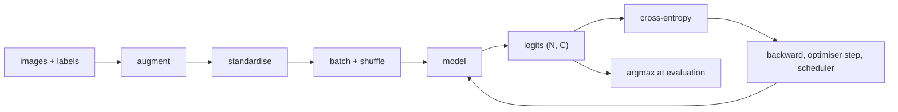

## Où ça s'inscrit

La classification est la compétence de base de la vision par ordinateur. La détection classe des régions ([[vis.03]]), la segmentation classe des pixels ([[vis.04]]), et la recherche d'images classe les images par similarité à une classe. Si tu sais construire un pipeline de classification fiable, tu peux déboguer tous les autres. La plupart des projets réels font ensuite une chose de plus : ils n'entraînent pas à partir de zéro, car des millions d'images étiquetées et des milliers d'heures de GPU ne sont pas disponibles. Ils partent d'un réseau pré-entraîné sur un grand jeu de données et l'adaptent. Cette leçon couvre les deux moitiés. Elle suppose que tu sais préparer des images ([[vis.01]]), que tu connais la régression logistique et l'entropie croisée ([[cml.02]], [[f2n.08]]), et que tu as rencontré la régularisation et les plannings de taux d'apprentissage ([[dl.02]], [[dl.01]]). Le réseau qui produit les caractéristiques est un CNN, traité dans [[seq.01]] ; ici c'est une boîte noire qui associe une image à un vecteur.

## L'idée en termes simples

Un classifieur est une fonction qui associe aux pixels une probabilité pour chaque classe. Entraîner, c'est lui montrer des exemples étiquetés et l'ajuster jusqu'à ce que la bonne classe obtienne une forte probabilité. Comme le même réseau voit chaque image de nombreuses fois, il peut mémoriser ; nous lui montrons donc des copies modifiées (retournements, recadrages) et nous le jugeons uniquement sur des images qu'il n'a jamais vues à l'entraînement.

Juger demande plus qu'un seul nombre. Si 90 % de tes images sont de la classe A, un modèle qui répond toujours A obtient 90 % et ne sert à rien. Nous regardons donc les erreurs classe par classe (un tableau de confusion), et pour les tâches aux classes réellement ambiguës nous demandons aussi si la bonne réponse figurait parmi les cinq meilleures hypothèses du modèle.

L'apprentissage par transfert, c'est emprunter une formation. Un réseau entraîné sur un million de photos du quotidien a appris à voir des contours, puis des textures, puis des parties, puis des formes d'objets. Les premières de ces compétences sont utiles pour presque toute photographie ; pour une nouvelle tâche, tu gardes donc les premières compétences presque intactes et tu ne ré-entraînes que la dernière partie, la plus spécialisée. Tu as deux façons de procéder. Tout garder gelé et n'enseigner qu'une nouvelle « couche de décision » au-dessus (peu coûteux, sûr, fonctionne avec peu d'images). Ou laisser tout le réseau s'adapter mais doucement, les premières couches bougeant le plus lentement, comme un chirurgien expérimenté qui apprend une nouvelle technique : on ne réécrit pas ses gestes de base.

## Le pipeline de classification



Chaque flèche peut cacher un bug. Les invariants à vérifier à chaque fois :

1. `model.train()` pour l'entraînement, `model.eval()` pour l'évaluation (cela change le comportement du dropout et de BatchNorm).
2. Remettre les gradients à zéro une fois par pas.
3. Donner à la perte les **logits**, pas les sorties du softmax (un softmax suivi d'une perte qui applique à nouveau le softmax calcule une quantité sans signification).
4. Évaluer sans gradients, et accumuler les métriques sous forme de nombres simples.
5. Augmenter uniquement les images d'entraînement ; les images de validation reçoivent la partie déterministe du pipeline.

## Dérivation : softmax, entropie croisée et gradient de la sonde linéaire

Un classifieur à $C$ classes produit des logits $z\in\mathbb{R}^C$. Le softmax les transforme en probabilités :

$$
p_i=\frac{e^{z_i}}{\sum_j e^{z_j}} .
$$

Pour une vraie classe $y$, la perte d'entropie croisée est l'opposé du logarithme de la probabilité de la bonne classe :

$$
\ell(z,y)=-\log p_y=-z_y+\log\sum_j e^{z_j}.
$$

La forme de droite est la forme numériquement stable (soustrais $\max_j z_j$ de tous les logits avant d'exponentier ; cela s'annule).

**Gradient par rapport aux logits.** Dérive $\ell=-z_y+\log\sum_j e^{z_j}$ par rapport à $z_i$ :

$$
\frac{\partial \ell}{\partial z_i}=-\mathbf 1[i=y]+\frac{e^{z_i}}{\sum_j e^{z_j}}=p_i-\mathbf 1[i=y].
$$

Sous forme vectorielle, $\nabla_z\ell=p-e_y$ où $e_y$ est le vecteur one-hot. « Prédiction moins cible » est la même règle simple que dans la régression logistique.

**Sonde linéaire.** Soit un backbone gelé qui fournit un vecteur de caractéristiques $x\in\mathbb{R}^d$ pour chaque image. Une sonde linéaire n'apprend que $W\in\mathbb{R}^{d\times C}$ et $b\in\mathbb{R}^C$ avec les logits $z=W^\top x+b$ (pour un lot, $Z=XW+b$). Pour un lot de $N$ images avec la matrice one-hot $Y\in\mathbb{R}^{N\times C}$ et les probabilités $P=\mathrm{softmax}(XW+b)$ ligne par ligne, la perte moyenne a pour gradients

$$
\nabla_W=\frac1N X^\top (P-Y)\in\mathbb{R}^{d\times C},\qquad
\nabla_b=\frac1N\sum_{n}(P-Y)_{n,:}\in\mathbb{R}^{C}.
$$

(La règle de la chaîne à travers $Z=XW+b$ donne $\partial\ell/\partial W=X^\top\,\partial\ell/\partial Z$.) La descente de gradient est alors $W\leftarrow W-\eta\nabla_W$. Comme $X$ est gelé, la perte est convexe en $(W,b)$ : il n'y a pas de mauvais minima locaux, ce qui fait d'une sonde une mesure propre de la qualité des caractéristiques.

**Lissage d'étiquettes (label smoothing).** Remplace la cible one-hot par $(1-\varepsilon)e_y+\varepsilon/C$ pour que le modèle ne soit pas poussé vers des logits infiniment grands ; cela améliore généralement la calibration. **Mixup** mélange deux images et leurs cibles one-hot avec un poids $\lambda\sim\mathrm{Beta}(\alpha,\alpha)$ ; l'entropie croisée contre la cible douce $-\sum_i t_i\log p_i$ est la même formule avec $t$ à la place de $e_y$.

## Évaluation

- **Précision top-$k$** : une prédiction est correcte si la vraie classe figure parmi les $k$ logits les plus élevés. Le top-5 compte pour les jeux de données avec des classes quasi identiques (deux races de chiens proches) ; $k=C$ donne toujours 1.
- **Matrice de confusion** $M\in\mathbb{N}^{C\times C}$ : $M_{ij}$ compte les images de vraie classe $i$ prédites comme $j$. La diagonale correspond aux bonnes réponses ; de grandes entrées hors diagonale indiquent pour quelle paire de classes collecter plus de données.
- **Précision et rappel par classe** à partir de cette matrice : la précision de la classe $j$ est $M_{jj}/\sum_i M_{ij}$, le rappel de la classe $i$ est $M_{ii}/\sum_j M_{ij}$.
- **Calibration** : une prédiction faite avec 80 % de confiance devrait être juste environ 80 % du temps. Les réseaux modernes sont trop confiants ; la mise à l'échelle par température ou le lissage d'étiquettes aident. Voir [[cml.10]] pour les métriques en général.

## Pourquoi le transfert fonctionne, et que faire

Les caractéristiques d'un CNN entraîné sur ImageNet ne sont pas liées à ses 1000 étiquettes. Elles capturent des statistiques d'images naturelles (contours orientés, textures, primitives de forme) valables dans la plupart des domaines. Les premières couches sont génériques ; les dernières sont spécifiques à la tâche. Deux régimes en découlent.

**Extraction de caractéristiques (backbone gelé).** Gèle tous les paramètres du backbone, remplace la couche finale, entraîne uniquement la nouvelle tête. Une sonde linéaire en est le cas extrême : une seule couche linéaire sur les caractéristiques gelées.

**Fine-tuning.** Tout ou partie du backbone est entraînable, avec un petit taux d'apprentissage pour que les caractéristiques pré-entraînées soient ajustées, pas détruites.

Une règle empirique de la leçon source, à traiter comme un point de départ à tester, pas comme une loi :

| images étiquetées | domaine proche des données de pré-entraînement | recette |
|---|---|---|
| moins d'environ 1k | oui | geler le backbone, entraîner la tête |
| environ 1k à 10k | oui | geler les premiers étages, fine-tuner le reste |
| environ 10k à 100k | tout | fine-tuner tout avec des taux d'apprentissage par couche |
| plus de 100k | éloigné | fine-tuner tout ; envisager l'entraînement à partir de zéro si le domaine est très différent |

Les scans médicaux, l'imagerie satellite et la microscopie sont des domaines « éloignés » : les caractéristiques aident encore, mais davantage de couches doivent s'adapter.

### Taux d'apprentissage par couche

Donne aux premières couches des pas plus petits qu'aux dernières. Deux plannings courants, avec des couches indexées de $k=0$ (la plus précoce) à $k=L$ (la tête).

**Décroissance par couche** (lisse, courante pour le fine-tuning des transformers) :

$$
\eta_k=\eta_{\text{base}}\;\gamma^{\,L-k},\qquad 0<\gamma<1 .
$$

**Groupé par étage** (courant pour les CNN) : un taux par étage, chacun étant une fraction fixe du suivant. Les deux s'implémentent dans les frameworks en passant à l'optimiseur une liste de groupes de paramètres, chacun avec son propre `lr`.

**Dégel progressif.** Commence avec seulement la tête entraînable ; à l'époque $e$, dégèle aussi les $e$ couches les plus proches de la tête. Reconstruis l'optimiseur chaque fois que l'ensemble entraînable change, sinon un état d'optimiseur périmé (moments des paramètres gelés) peut l'induire en erreur.

### Pièges de BatchNorm

Les couches BatchNorm conservent des moyennes et variances glissantes issues des données de pré-entraînement ([[dl.03]]). Sur un petit jeu de données différent, elles sont fausses ou bruitées. Options, dans l'ordre de préférence de la source : fine-tuner avec BN en mode entraînement si le jeu de données est de taille moyenne ; geler les statistiques BN (mode eval) s'il est très petit ; ou remplacer BN par une normalisation de groupe lorsque les lots sont minuscules (fréquent en détection). Se tromper ici peut coûter plusieurs points de précision sans aucun message d'erreur.

### Que rapporter

Rapporte toujours deux nombres : la **précision gelée (sonde linéaire)**, ton plancher, et la **précision après fine-tuning**, ton plafond. Si le fine-tuning est moins bon que la sonde, soupçonne un taux d'apprentissage trop élevé (destruction des caractéristiques), un problème de BatchNorm ou un bug.

## Exemple travaillé

Tout ce qui suit est reproduit par le code de l'exercice.

**Softmax, entropie croisée et top-k.** Trois images, trois classes, logits et étiquettes :

| ligne | logits | étiquette | softmax | perte CE |
|---|---|---|---|---|
| 0 | (2.0, 1.0, 0.1) | 0 | (0.659, 0.242, 0.099) | 0.417 |
| 1 | (0.1, 0.2, 3.0) | 1 | (0.049, 0.054, 0.896) | 2.910 |
| 2 | (1.0, 1.5, 1.2) | 0 | (0.258, 0.426, 0.316) | 1.353 |

Les prédictions top-1 sont les classes 0, 2, 1, donc la précision top-1 vaut $1/3$. L'étiquette de la ligne 1 (classe 1) est le deuxième plus grand logit, c'est donc un succès top-2 ; l'étiquette de la ligne 2 (classe 0) a le plus petit logit, c'est donc un échec même pour $k=2$. La précision top-2 vaut $2/3$ et la précision top-3 vaut $1$.

**Sonde linéaire sur des caractéristiques gelées synthétiques.** Quatre classes, $d=12$ caractéristiques, moyennes de classes tirées à l'échelle 1.5 plus un bruit gaussien unitaire, 400 images d'entraînement et 300 de test (la configuration à graine fixée des tests de l'exercice). La descente de gradient sur lot complet avec $\eta=0.5$ à partir de poids nuls donne, après 1, 10 et 300 pas, une précision de test de $0.913$, $0.993$ et $0.997$. Les classes synthétiques sont bien séparées, donc même un pas fonctionne presque ; de vraies caractéristiques demandent plus de soin, mais la mécanique est la même.

**Taux d'apprentissage par couche.** Avec $L=12$ blocs, $\gamma=0.75$ et un taux de tête de $10^{-3}$, le bloc 0 reçoit $10^{-3}\cdot0.75^{12}=3.17\times10^{-5}$, le bloc 4 reçoit $1.00\times10^{-4}$, le bloc 8 reçoit $3.16\times10^{-4}$, et le bloc 11 reçoit $7.5\times10^{-4}$. Le premier bloc bouge environ 32 fois plus lentement que la tête. (La source cite $0.75^{11}\approx0.04$ pour 12 blocs indexés de sorte que la tête se trouve un cran au-dessus du dernier bloc ; l'exposant dépend de l'endroit où l'on compte la tête.) Un planning groupé par étage avec six groupes, une décroissance de $0.3$ et une base de $10^{-3}$ donne, du stem à la tête, $2.4\times10^{-6}$, $8.1\times10^{-6}$, $2.7\times10^{-5}$, $9\times10^{-5}$, $3\times10^{-4}$, $10^{-3}$.

**Dégel progressif.** Avec 4 couches de backbone plus la tête (indices 0..4), l'époque 0 entraîne $\{4\}$, l'époque 2 entraîne $\{2,3,4\}$, et à partir de l'époque 4 tout est entraîné.

## Implémentation

```python
import numpy as np

def topk_accuracy(logits, y, k):
    top = np.argsort(-logits, axis=1)[:, :k]
    return float(np.mean([y[i] in top[i] for i in range(len(y))]))

def fit_linear_probe(X, y, n_classes, lr=0.5, steps=300):
    N, d = X.shape
    W, b = np.zeros((d, n_classes)), np.zeros(n_classes)
    Y = np.eye(n_classes)[y]
    for _ in range(steps):
        Z = X @ W + b
        Z -= Z.max(axis=1, keepdims=True)           # stability
        P = np.exp(Z); P /= P.sum(axis=1, keepdims=True)
        G = (P - Y) / N
        W -= lr * (X.T @ G)
        b -= lr * G.sum(axis=0)
    return W, b

def layerwise_lrs(base_lr, decay, n_layers):
    return [base_lr * decay ** (n_layers - k) for k in range(n_layers + 1)]
```

En PyTorch, geler s'écrit `p.requires_grad = False` pour les paramètres du backbone, une nouvelle tête est `nn.Linear(in_features, num_classes)`, et les taux par couche s'écrivent `optimizer = SGD([{"params": ..., "lr": ...}, ...])`. Des bibliothèques comme `timm` et `torchvision.models` fournissent les backbones pré-entraînés.

## Formes

| objet | forme |
|---|---|
| lot d'images | $(N,3,H,W)$ |
| caractéristiques du backbone | $(N,d)$ |
| poids de la sonde, biais | $(d,C)$, $(C,)$ |
| logits, probabilités | $(N,C)$ |
| gradient de la perte moyenne par rapport à $W$ | $(d,C)$ |
| matrice de confusion | $(C,C)$ |

## Idées reçues

- **« La précision suffit. »** Avec un déséquilibre, elle cache les échecs ; lis la matrice de confusion et le rappel par classe.
- **« Applique le softmax avant la perte. »** La perte attend des logits ; un double softmax donne silencieusement de mauvais gradients.
- **« Le fine-tuning bat toujours un backbone gelé. »** Avec très peu de données ou un mauvais taux d'apprentissage, il est moins bon. Mesure les deux.
- **« Utilise le même taux d'apprentissage partout. »** Trop élevé pour les premières couches, il détruit les caractéristiques pré-entraînées (oubli catastrophique) ; les taux par couche en protègent.
- **« Pré-entraîné veut dire que les statistiques BN me conviennent. »** Elles décrivent les données de pré-entraînement, pas les tiennes.
- **« La précision de la sonde mesure tout le modèle. »** Elle mesure à quel point les caractéristiques gelées sont linéairement séparables pour tes classes, rien de plus.
- **« L'augmentation est gratuite. »** Elle doit préserver les étiquettes et ne doit pas être appliquée au moment du test.

## Points clés à retenir

- Classification = logits, softmax, entropie croisée ; le gradient par rapport aux logits est $p-e_y$.
- Évalue avec top-1/top-$k$, une matrice de confusion et des chiffres par classe, sur des données que le modèle n'a jamais vues.
- Transfert : caractéristiques gelées + sonde linéaire d'abord (le plancher), puis fine-tuning avec des taux plus petits pour les premières couches.
- Adapte la recette à la taille du jeu de données et à l'éloignement du domaine ; surveille BatchNorm.
- Rapporte toujours à la fois les résultats de la sonde et ceux du fine-tuning.

## Explique-le toi-même

1. Dérive $\partial\ell/\partial z_i=p_i-\mathbf 1[i=y]$ puis le gradient de la sonde $\frac1N X^\top(P-Y)$.
2. Tu as 800 images de microscope étiquetées. Quelle recette de transfert essaies-tu en premier, que mesures-tu, et qu'est-ce qui te ferait dégeler davantage de couches ?

## Pour aller plus loin

- Les listes de lectures des deux leçons sources (mixup, mise à l'échelle par température, « How transferable are features in deep neural networks? », ULMFiT pour les taux discriminatifs).
- [[seq.01]] pour voir comment les étages d'un CNN produisent la hiérarchie de caractéristiques qui rend le transfert possible ; [[dl.02]] pour la régularisation et l'augmentation comme régularisateurs.

## Critères de maîtrise

Tu sais dériver et implémenter la régression softmax sur des caractéristiques gelées, calculer la précision top-$k$ et une matrice de confusion, choisir entre extraction de caractéristiques et fine-tuning à partir de la description d'un jeu de données, et écrire la logique de taux d'apprentissage et de dégel pour un modèle en couches.
