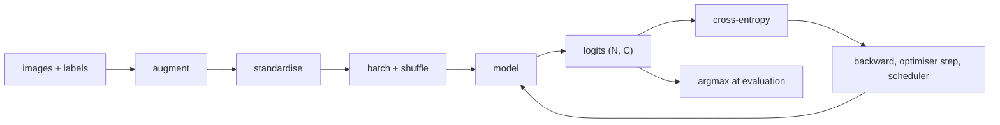

## Where this fits

Classification is the base skill of computer vision. Detection classifies regions ([[vis.03]]), segmentation classifies pixels ([[vis.04]]), and retrieval ranks images by similarity to a class. If you can build a trustworthy classification pipeline, you can debug all of them. Most real projects then do one more thing: they do not train from scratch, because millions of labelled images and thousands of GPU-hours are not available. They start from a network pre-trained on a large dataset and adapt it. This lesson covers both halves. It assumes you can prepare images ([[vis.01]]), know logistic regression and cross-entropy ([[cml.02]], [[f2n.08]]), and have met regularisation and learning-rate schedules ([[dl.02]], [[dl.01]]). The network that produces the features is a CNN, covered in [[seq.01]]; here it is a black box that maps an image to a vector.

## The idea in plain words

A classifier is a function from pixels to a probability for each class. Training means showing it labelled examples and nudging it until the correct class gets high probability. Because the same network sees each picture many times, it can memorise, so we show it altered copies (flips, crops) and we judge it only on pictures it never trained on.

Judging needs more than one number. If 90% of your images are class A, a model that always says A scores 90% and is useless. So we look at the errors class by class (a confusion table), and for tasks with genuinely ambiguous classes we also ask whether the right answer was in the model's top five guesses.

Transfer learning is borrowing an education. A network trained on a million everyday photos learned to see edges, then textures, then parts, then object-like shapes. The first of those skills are useful for almost any photograph, so for a new task you keep the early skills nearly untouched and only retrain the last, most specialised part. You have two ways to do it. Keep everything frozen and teach only a new "decision layer" on top (cheap, safe, works with few images). Or let the whole network adapt but gently, with the early layers moving the slowest, like an experienced surgeon learning a new technique: you do not rewrite their basic hand skills.

## The classification pipeline



Every arrow can hide a bug. The invariants to check each time:

1. `model.train()` for training, `model.eval()` for evaluation (this switches dropout and BatchNorm behaviour).
2. Zero the gradients once per step.
3. Feed the loss the **logits**, not softmax outputs (softmax followed by a loss that applies softmax again computes a meaningless quantity).
4. Evaluate without gradients, and accumulate metrics as plain numbers.
5. Augment training images only; validation images get the deterministic part of the pipeline.

## Derivation: softmax, cross-entropy and the linear probe gradient

A classifier with $C$ classes outputs logits $z\in\mathbb{R}^C$. Softmax turns them into probabilities:

$$
p_i=\frac{e^{z_i}}{\sum_j e^{z_j}} .
$$

For a true class $y$ the cross-entropy loss is the negative log-probability of the correct class:

$$
\ell(z,y)=-\log p_y=-z_y+\log\sum_j e^{z_j}.
$$

The right-hand form is the numerically stable one (subtract $\max_j z_j$ from all logits before exponentiating; it cancels).

**Gradient with respect to the logits.** Differentiate $\ell=-z_y+\log\sum_j e^{z_j}$ with respect to $z_i$:

$$
\frac{\partial \ell}{\partial z_i}=-\mathbf 1[i=y]+\frac{e^{z_i}}{\sum_j e^{z_j}}=p_i-\mathbf 1[i=y].
$$

In vector form $\nabla_z\ell=p-e_y$ where $e_y$ is the one-hot vector. "Prediction minus target" is the same clean rule as in logistic regression.

**Linear probe.** Let the frozen backbone give a feature vector $x\in\mathbb{R}^d$ for each image. A linear probe learns only $W\in\mathbb{R}^{d\times C}$ and $b\in\mathbb{R}^C$ with logits $z=W^\top x+b$ (for a batch, $Z=XW+b$). For a batch of $N$ images with one-hot matrix $Y\in\mathbb{R}^{N\times C}$ and probabilities $P=\mathrm{softmax}(XW+b)$ row-wise, the mean loss has the gradients

$$
\nabla_W=\frac1N X^\top (P-Y)\in\mathbb{R}^{d\times C},\qquad
\nabla_b=\frac1N\sum_{n}(P-Y)_{n,:}\in\mathbb{R}^{C}.
$$

(The chain rule through $Z=XW+b$ gives $\partial\ell/\partial W=X^\top\,\partial\ell/\partial Z$.) Gradient descent is then $W\leftarrow W-\eta\nabla_W$. Because $X$ is frozen, the loss is convex in $(W,b)$: there are no bad local minima, which is why a probe is a clean measurement of feature quality.

**Label smoothing.** Replace the one-hot target by $(1-\varepsilon)e_y+\varepsilon/C$ so the model is not pushed to infinitely large logits; this typically improves calibration. **Mixup** blends two images and their one-hot targets with weight $\lambda\sim\mathrm{Beta}(\alpha,\alpha)$; cross-entropy against the soft target $-\sum_i t_i\log p_i$ is the same formula with $t$ in place of $e_y$.

## Evaluation

- **Top-$k$ accuracy**: a prediction counts as correct if the true class is among the $k$ highest logits. Top-5 matters for datasets with near-duplicate classes (two similar dog breeds); $k=C$ always gives 1.
- **Confusion matrix** $M\in\mathbb{N}^{C\times C}$: $M_{ij}$ counts images of true class $i$ predicted as $j$. The diagonal is correct; large off-diagonal entries tell you which pair of classes to collect more data for.
- **Per-class precision and recall** from that matrix: precision of class $j$ is $M_{jj}/\sum_i M_{ij}$, recall of class $i$ is $M_{ii}/\sum_j M_{ij}$.
- **Calibration**: a prediction made with 80% confidence should be right about 80% of the time. Modern networks are over-confident; temperature scaling or label smoothing helps. See [[cml.10]] for metrics in general.

## Why transfer works, and what to do

The features of an ImageNet-trained CNN are not tied to its 1000 labels. They capture statistics of natural images (oriented edges, textures, shape primitives) that hold in most domains. Early layers are generic; late layers are task-specific. Two regimes follow.

**Feature extraction (frozen backbone).** Freeze all backbone parameters, replace the final layer, train only the new head. A linear probe is the extreme: a single linear layer on the frozen features.

**Fine-tuning.** All or part of the backbone is trainable, with a small learning rate so pre-trained features are adjusted, not destroyed.

A rule of thumb from the source lesson, to be treated as a starting point to test, not a law:

| labelled images | domain close to the pre-training data | recipe |
|---|---|---|
| under about 1k | yes | freeze the backbone, train the head |
| about 1k to 10k | yes | freeze early stages, fine-tune the rest |
| about 10k to 100k | any | fine-tune everything with per-layer learning rates |
| above 100k | far | fine-tune everything; consider training from scratch if the domain is very different |

Medical scans, satellite imagery and microscopy are "far" domains: features still help, but more layers must adapt.

### Per-layer learning rates

Give early layers smaller steps than late ones. Two common schedules, with layers indexed $k=0$ (earliest) to $k=L$ (head).

**Layer-wise decay** (smooth, common for transformer fine-tuning):

$$
\eta_k=\eta_{\text{base}}\;\gamma^{\,L-k},\qquad 0<\gamma<1 .
$$

**Stage-grouped** (common for CNNs): one rate per stage, each a fixed fraction of the next one. Both are implemented in frameworks by passing a list of parameter groups, each with its own `lr`, to the optimiser.

**Progressive unfreezing.** Start with only the head trainable; at epoch $e$ also unfreeze the $e$ layers closest to the head. Rebuild the optimiser whenever the trainable set changes, otherwise stale optimiser state (moments of frozen parameters) can mislead it.

### BatchNorm pitfalls

BatchNorm layers keep running means and variances from the pre-training data ([[dl.03]]). On a small, different dataset these are wrong or noisy. Options, in the source's order of preference: fine-tune with BN in training mode if the dataset is medium-sized; freeze BN statistics (eval mode) if it is very small; or replace BN with group normalisation when batches are tiny (common in detection). Getting this wrong can cost several points of accuracy without any error message.

### What to report

Always report two numbers: the **frozen (linear probe) accuracy**, your floor, and the **fine-tuned accuracy**, your ceiling. If fine-tuning is worse than the probe, suspect a learning rate that is too high (feature destruction), a BatchNorm problem, or a bug.

## Worked example

Everything below is reproduced by the exercise code.

**Softmax, cross-entropy and top-k.** Three images, three classes, logits and labels:

| row | logits | label | softmax | CE loss |
|---|---|---|---|---|
| 0 | (2.0, 1.0, 0.1) | 0 | (0.659, 0.242, 0.099) | 0.417 |
| 1 | (0.1, 0.2, 3.0) | 1 | (0.049, 0.054, 0.896) | 2.910 |
| 2 | (1.0, 1.5, 1.2) | 0 | (0.258, 0.426, 0.316) | 1.353 |

Top-1 predictions are classes 0, 2, 1, so top-1 accuracy is $1/3$. Row 1's label (class 1) is the second-largest logit, so it is a top-2 hit; row 2's label (class 0) has the smallest logit, so it is a miss even at $k=2$. Top-2 accuracy is $2/3$ and top-3 accuracy is $1$.

**Linear probe on synthetic frozen features.** Four classes, $d=12$ features, class means drawn at scale 1.5 plus unit Gaussian noise, 400 training and 300 test images (the seeded setup in the exercise tests). Full-batch gradient descent with $\eta=0.5$ from zero weights gives, after 1, 10 and 300 steps, test accuracy $0.913$, $0.993$ and $0.997$. The synthetic classes are well separated, so even one step nearly works; real features need more care, but the mechanics are the same.

**Layer-wise learning rates.** With $L=12$ blocks, $\gamma=0.75$ and head rate $10^{-3}$, block 0 gets $10^{-3}\cdot0.75^{12}=3.17\times10^{-5}$, block 4 gets $1.00\times10^{-4}$, block 8 gets $3.16\times10^{-4}$, and block 11 gets $7.5\times10^{-4}$. The first block moves about 32 times slower than the head. (The source quotes $0.75^{11}\approx0.04$ for 12 blocks indexed so that the head sits one step above the last block; the exponent depends on where you count the head.) A stage-grouped schedule with six groups and decay $0.3$ and base $10^{-3}$ gives, from stem to head, $2.4\times10^{-6}$, $8.1\times10^{-6}$, $2.7\times10^{-5}$, $9\times10^{-5}$, $3\times10^{-4}$, $10^{-3}$.

**Progressive unfreezing.** With 4 backbone layers plus the head (indices 0..4), epoch 0 trains $\{4\}$, epoch 2 trains $\{2,3,4\}$, and from epoch 4 on everything trains.

## Implementation

```python
import numpy as np

def topk_accuracy(logits, y, k):
    top = np.argsort(-logits, axis=1)[:, :k]
    return float(np.mean([y[i] in top[i] for i in range(len(y))]))

def fit_linear_probe(X, y, n_classes, lr=0.5, steps=300):
    N, d = X.shape
    W, b = np.zeros((d, n_classes)), np.zeros(n_classes)
    Y = np.eye(n_classes)[y]
    for _ in range(steps):
        Z = X @ W + b
        Z -= Z.max(axis=1, keepdims=True)           # stability
        P = np.exp(Z); P /= P.sum(axis=1, keepdims=True)
        G = (P - Y) / N
        W -= lr * (X.T @ G)
        b -= lr * G.sum(axis=0)
    return W, b

def layerwise_lrs(base_lr, decay, n_layers):
    return [base_lr * decay ** (n_layers - k) for k in range(n_layers + 1)]
```

In PyTorch, freezing is `p.requires_grad = False` for backbone parameters, a new head is `nn.Linear(in_features, num_classes)`, and per-layer rates are `optimizer = SGD([{"params": ..., "lr": ...}, ...])`. Libraries such as `timm` and `torchvision.models` provide the pre-trained backbones.

## Shapes

| object | shape |
|---|---|
| batch of images | $(N,3,H,W)$ |
| backbone features | $(N,d)$ |
| probe weights, bias | $(d,C)$, $(C,)$ |
| logits, probabilities | $(N,C)$ |
| gradient of mean loss w.r.t. $W$ | $(d,C)$ |
| confusion matrix | $(C,C)$ |

## Common misconceptions

- **"Accuracy is enough."** With imbalance it hides failures; read the confusion matrix and per-class recall.
- **"Apply softmax before the loss."** The loss expects logits; double softmax silently gives wrong gradients.
- **"Fine-tuning always beats a frozen backbone."** With very small data or a bad learning rate it is worse. Measure both.
- **"Use the same learning rate everywhere."** Too high for early layers destroys pre-trained features (catastrophic forgetting); per-layer rates guard against it.
- **"Pre-trained means the BN statistics are right for me."** They describe the pre-training data, not yours.
- **"The probe's accuracy measures the whole model."** It measures how linearly separable the frozen features are for your classes, nothing more.
- **"Augmentation is free."** It must preserve labels and must not be applied at test time.

## Key takeaways

- Classification = logits, softmax, cross-entropy; the logit gradient is $p-e_y$.
- Evaluate with top-1/top-$k$, a confusion matrix and per-class numbers, on data the model never saw.
- Transfer: frozen features + linear probe first (the floor), then fine-tune with smaller rates for earlier layers.
- Match the recipe to dataset size and domain distance; watch BatchNorm.
- Always report both the probe and the fine-tuned results.

## Explain it yourself

1. Derive $\partial\ell/\partial z_i=p_i-\mathbf 1[i=y]$ and then the probe gradient $\frac1N X^\top(P-Y)$.
2. You have 800 labelled microscope images. Which transfer recipe do you try first, what do you measure, and what would make you unfreeze more layers?

## Further reading

- The two source lessons' reading lists (mixup, temperature scaling, "How transferable are features in deep neural networks?", ULMFiT for discriminative rates).
- [[seq.01]] for how CNN stages produce the feature hierarchy that makes transfer work; [[dl.02]] for regularisation and augmentation as regularisers.

## Mastery criteria

You can derive and implement softmax regression on frozen features, compute top-$k$ accuracy and a confusion matrix, choose between feature extraction and fine-tuning given a dataset description, and write the learning-rate and unfreezing logic for a layered model.
