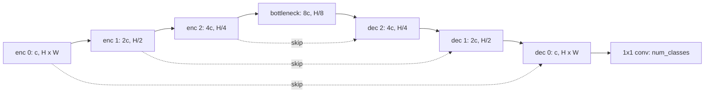

## Où ça s'inscrit

Certaines questions demandent plus qu'une boîte. Quelle est la taille de la tumeur, quels pixels sont de la route, combien de cellules distinctes se touchent ? La segmentation répond en étiquetant des pixels. Elle réutilise la classification ([[vis.02]]) à une granularité beaucoup plus fine, réutilise les briques convolutives ([[seq.01]], [[vis.01]]) dans une nouvelle disposition, et pour la segmentation d'instances elle ajoute une branche de masque au détecteur de [[vis.03]]. Les mesures de recouvrement d'ici (IoU et Dice) sont la version masque de l'IoU de boîtes que tu connais déjà.

## L'idée en termes simples

La classification regarde l'image entière et répond par une seule étiquette. Pour étiqueter chaque pixel, le réseau a besoin de deux compétences à la fois : voir le contexte (« c'est une scène de rue, donc cette région grise est probablement de la route ») et garder le détail précis (« la route s'arrête exactement ici »). Un CNN normal obtient le contexte en rétrécissant l'image encore et encore, ce qui jette le détail.

**U-Net** résout cela avec une conception en forme de U. Le côté gauche (l'encodeur) rétrécit l'image en cherchant des motifs de plus en plus abstraits. Le côté droit (le décodeur) la ramène à sa taille initiale. Au milieu, des ponts (**connexions de saut**) transmettent les cartes de caractéristiques nettes et haute résolution du côté gauche directement au niveau correspondant du côté droit, afin que le décodeur n'ait pas à se souvenir d'un détail fin qu'il n'a jamais vu.

Trois variantes de la tâche :

- **Segmentation sémantique** : chaque pixel reçoit une classe (« voiture », « route »). Deux voitures qui se touchent deviennent une seule tache.
- **Segmentation d'instances** : chaque objet reçoit son propre masque et son identité (« voiture 1 », « voiture 2 »), le « stuff » d'arrière-plan étant ignoré.
- **Panoptique** : les deux : chaque pixel a une classe et, pour les choses dénombrables, un identifiant d'instance.

Pour la segmentation d'instances, l'idée la plus propre est : détecter chaque objet avec une boîte ([[vis.03]]), puis, à l'intérieur de chaque boîte, exécuter un petit réseau qui prédit le masque de cet objet.

## Segmentation sémantique

### La forme du U-Net

Avec une entrée $H\times W$ et une largeur de base de $c$ canaux, une profondeur $D$ signifie $D$ étages d'encodeur. L'étage $k$ ($k=0,\dots,D-1$) travaille à la résolution $(H/2^k)\times(W/2^k)$ avec $c\,2^k$ canaux ; le pooling ou la convolution à pas divise la résolution par deux entre les étages. Un goulot d'étranglement se trouve à $(H/2^D)\times(W/2^D)$ avec $c\,2^D$ canaux. Le décodeur reflète l'encodeur : il suréchantillonne d'un facteur 2, **concatène** la carte de caractéristiques de l'encodeur de même résolution (le saut), et applique des convolutions qui ramènent le nombre de canaux vers le bas. Une convolution finale $1\times1$ associe $c$ canaux au nombre de classes.



Comme chaque étage divise la taille par deux, $H$ et $W$ doivent être divisibles par $2^D$ (pour $D=4$ : par 16).

**Pourquoi des sauts.** Au goulot d'étranglement, la grille spatiale est minuscule ; l'information sur l'endroit exact où se trouvait un contour a été compressée. Concaténer la carte de l'encodeur à la même résolution la restaure.

**Suréchantillonnage.** Une convolution transposée apprend le suréchantillonnage mais peut produire des artefacts en damier si le pas et la taille du noyau ne se divisent pas exactement. Un suréchantillonnage bilinéaire suivi d'une convolution $3\times3$ a moins d'artefacts et de paramètres et c'est un défaut moderne courant.

**Résolution et mémoire.** La mémoire croît avec $H\cdot W\cdot c_{\max}$. Les grandes images sont découpées en tuiles qui se chevauchent, ou le goulot d'étranglement est remplacé par des convolutions dilatées (la famille DeepLab).

### Entropie croisée par pixel

La sortie est constituée de logits $(N,C,H,W)$ et la cible est $(N,H,W)$ d'identifiants de classe entiers. La perte est l'entropie croisée de classification de [[vis.02]] à chaque pixel, moyennée :

$$
L_{\text{CE}}=-\frac{1}{NHW}\sum_{n,h,w}\log\operatorname{softmax}\big(z_{n,:,h,w}\big)_{y_{n,h,w}} .
$$

Sa faiblesse est que chaque pixel compte de la même façon. Si 99 % des pixels sont de l'arrière-plan, prédire « arrière-plan » partout donne 99 % de précision par pixel et un modèle inutile.

### Mesures de recouvrement : IoU et Dice

Pour un masque binaire prédit $P$ et un masque de vérité terrain $Y$ (ensembles de pixels) :

$$
\mathrm{IoU}=\frac{|P\cap Y|}{|P\cup Y|}=\frac{|P\cap Y|}{|P|+|Y|-|P\cap Y|},\qquad
\mathrm{Dice}=\frac{2|P\cap Y|}{|P|+|Y|} .
$$

**Relation entre les deux.** Soit $I=|P\cap Y|$ et $S=|P|+|Y|$. Alors $\mathrm{Dice}=2I/S$ et $\mathrm{IoU}=I/(S-I)$. Résous la seconde pour $I$ : $I=\mathrm{IoU}\,(S-I)\Rightarrow I(1+\mathrm{IoU})=\mathrm{IoU}\,S\Rightarrow I/S=\mathrm{IoU}/(1+\mathrm{IoU})$. En substituant dans Dice :

$$
\mathrm{Dice}=\frac{2\,\mathrm{IoU}}{1+\mathrm{IoU}} .
$$

Les deux sont reliées de façon monotone, elles classent donc les modèles de la même manière ; l'imagerie médicale rapporte le Dice, les benchmarks de conduite rapportent l'IoU.

**Perte Dice douce.** Pour entraîner par descente de gradient, remplace le masque dur $P$ par des probabilités prédites $p\in[0,1]^{HW}$ (sigmoïde pour une classe binaire, softmax par classe sinon) et les ensembles par des sommes :

$$
\mathrm{Dice}(p,y)=\frac{2\sum_i p_iy_i}{\sum_i p_i+\sum_i y_i+\varepsilon},\qquad L_{\text{Dice}}=1-\mathrm{Dice}(p,y).
$$

Le petit $\varepsilon$ évite $0/0$ sur les masques vides. Comme le numérateur et le dénominateur sont tous deux des sommes sur toute l'image, une minuscule région de premier plan compte autant qu'une grande : la perte est insensible au nombre de pixels d'arrière-plan. L'objectif d'entraînement habituel combine les deux pertes, $L=L_{\text{CE}}+\lambda L_{\text{Dice}}$ avec $\lambda\approx1$ : l'entropie croisée donne des gradients stables au début, Dice affine le recouvrement à la fin.

**Évaluation multi-classes.** Construis la matrice de confusion $M$ sur tous les pixels ($M_{ij}$ = pixels de vraie classe $i$ prédits comme $j$). L'IoU par classe est $M_{cc}/(\sum_jM_{cj}+\sum_iM_{ic}-M_{cc})$ et l'**IoU moyenne** (mIoU) fait la moyenne sur les classes. Rapporte aussi l'IoU par classe, car la moyenne cache une classe bloquée à 15 % parmi neuf à 85 %. Les scores basés sur les frontières comptent quand les contours fins sont le but.

## Segmentation d'instances : l'idée de Mask R-CNN

Mask R-CNN étend un détecteur en deux étapes (Faster R-CNN) avec une branche de masque :

1. Un **backbone** (par exemple un ResNet) plus un **réseau à pyramide de caractéristiques** produisent des cartes de caractéristiques multi-échelles.
2. Un **réseau de propositions de régions (RPN)** place des boîtes d'ancrage à chaque position, prédit « objet ou non » et une correction de boîte pour chacune, et garde environ un millier de propositions après NMS.
3. **RoIAlign** découpe un patch de caractéristiques de taille fixe (par exemple $7\times7$ ou $14\times14$) dans la carte de caractéristiques pour chaque proposition.
4. Une **tête de boîte** classe le patch et affine la boîte ; une petite **tête de masque** convolutive prédit un masque binaire basse résolution par classe (par exemple $28\times28$). Seul le masque de la classe prédite est utilisé, ce qui découple la prédiction du masque de la classification. Le masque est ensuite redimensionné à la boîte en coordonnées d'image.

La perte totale ajoute les pertes du RPN (objectité et boîte), les pertes de la tête de boîte (entropie croisée sur les classes y compris l'arrière-plan, et une régression de boîte smooth-L1) et une entropie croisée binaire par pixel pour le masque.

### RoIAlign

Les coins d'une proposition ont des coordonnées à valeurs réelles en unités de la carte de caractéristiques, mais la carte de caractéristiques est une grille. L'ancien RoIPool **arrondissait** la boîte et chacune de ses cellules à des entiers ; avec un pas de caractéristiques de 32, une erreur d'arrondi d'une demi-cellule représente 16 pixels d'image, ce qui désaligne les caractéristiques et le masque. **RoIAlign** conserve les coordonnées réelles et lit chaque point d'échantillonnage par **interpolation bilinéaire**.

Pour un point $(y,x)$ avec $y_0=\lfloor y\rfloor$, $x_0=\lfloor x\rfloor$, $w_y=y-y_0$, $w_x=x-x_0$, et une carte de caractéristiques $f$ :

$$
f(y,x)=(1-w_y)(1-w_x)f_{y_0,x_0}+(1-w_y)w_xf_{y_0,x_0+1}+w_y(1-w_x)f_{y_0+1,x_0}+w_yw_xf_{y_0+1,x_0+1}.
$$

Ce sont deux interpolations linéaires successives, une selon $x$ et une selon $y$. Vérification : si $f$ est linéaire, $f(y,x)=ay+bx+c$, l'interpolation bilinéaire la reproduit exactement, ce qui est un test pratique. Pour regrouper une boîte en une sortie $m\times m$, divise-la en $m\times m$ cases égales et échantillonne aux centres des cases (l'opérateur réel moyenne plusieurs points d'échantillonnage par case). La source rapporte que remplacer RoIPool par RoIAlign a augmenté l'AP des masques d'environ 3-4 points sur COCO.

L'implémentation de torchvision renvoie, par image, un dictionnaire avec `boxes` $(K,4)$, `labels` $(K,)$, `scores` $(K,)$ et `masks` $(K,1,H,W)$ (seuil à 0.5 pour un masque binaire).

## Exemple travaillé

Tous les nombres sont reproduits par le code de l'exercice.

**Dice et IoU de deux masques $4\times4$.** La vérité terrain a des uns en $(0,1),(0,2),(1,1),(1,2)$ (un bloc $2\times2$, $|Y|=4$). La prédiction a des uns en $(0,1),(0,2),(0,3),(1,1)$ ($|P|=4$). Le recouvrement est $(0,1),(0,2),(1,1)$, donc $|P\cap Y|=3$. Alors $\mathrm{Dice}=2\cdot3/8=0.75$ et $\mathrm{IoU}=3/(4+4-3)=0.6$. Vérifie la relation : $2\cdot0.6/1.6=0.75$. La perte Dice vaut $0.25$.

**Déséquilibre.** Une image $10\times10$ avec un seul pixel de premier plan et une prédiction entièrement arrière-plan a une précision par pixel de $0.99$ mais un Dice de $0$.

**IoU moyenne.** Les prédictions `[[0,0,1],[1,2,2]]` contre les cibles `[[0,1,1],[1,2,0]]` donnent la matrice de confusion (lignes = vraie classe)
`[[1,0,1],[1,2,0],[0,0,1]]`. IoU par classe : classe 0 $1/(2+2-1)=1/3$ ; classe 1 $2/(3+2-2)=2/3$ ; classe 2 $1/(1+2-1)=1/2$. mIoU $=0.5$.

**Formes d'un U-Net.** Entrée $64\times64$, 16 canaux de base, profondeur 3 : $(16,64,64)\to(32,32,32)\to(64,16,16)\to$ goulot d'étranglement $(128,8,8)\to(64,16,16)\to(32,32,32)\to(16,64,64)$. Une entrée $60\times64$ échouerait car 60 n'est pas divisible par $2^3=8$.

**RoIAlign.** Sur la carte de caractéristiques en rampe $f(y,x)=5y+x$ (un tableau $5\times5$ de $0..24$), $f(1.5,2.25)=9.75$. Regrouper la boîte $(0.5,0.5,3.5,3.5)$ en cases $3\times3$ échantillonne les centres $y,x\in\{1,2,3\}$ et renvoie $[[6,7,8],[11,12,13],[16,17,18]]$. Pour la boîte $(0.6,0.6,3.6,3.6)$, arrondir d'abord les coins (en $(1,1,4,4)$) déplace chaque centre d'échantillonnage de $0.4$ sur chaque axe ; sur cette rampe les valeurs regroupées diffèrent de plus de $2$, une mesure directe du désalignement.

## Implémentation

```python
import numpy as np

def dice_score(p, y, eps=1e-9):
    return 2 * np.sum(p * y) / (np.sum(p) + np.sum(y) + eps)

def iou_score(p, y, eps=1e-9):
    inter = np.sum(p * y)
    return inter / (np.sum(p) + np.sum(y) - inter + eps)

def confusion_matrix(pred, target, n_classes):
    cm = np.zeros((n_classes, n_classes), dtype=int)
    np.add.at(cm, (target.ravel(), pred.ravel()), 1)
    return cm

def bilinear_sample(feat, y, x):
    H, W = feat.shape
    y = min(max(y, 0.0), H - 1.0); x = min(max(x, 0.0), W - 1.0)
    y0, x0 = int(np.floor(y)), int(np.floor(x))
    y1, x1 = min(y0 + 1, H - 1), min(x0 + 1, W - 1)
    wy, wx = y - y0, x - x0
    return ((1-wy)*(1-wx)*feat[y0, x0] + (1-wy)*wx*feat[y0, x1]
            + wy*(1-wx)*feat[y1, x0] + wy*wx*feat[y1, x1])
```

En pratique, tu utilises `segmentation_models_pytorch` ou `monai` pour les U-Net et leurs pertes, `torchvision.models.detection.maskrcnn_resnet50_fpn_v2` pour Mask R-CNN (affiné en remplaçant les têtes de boîte et de masque), et `torchvision.ops.roi_align` pour l'opérateur.

## Formes

| objet | forme |
|---|---|
| entrée | $(N,3,H,W)$ |
| logits | $(N,C,H,W)$ |
| cible sémantique | $(N,H,W)$ d'identifiants entiers |
| masque binaire / carte de probabilités | $(N,1,H,W)$ ou $(H,W)$ |
| matrice de confusion | $(C,C)$ |
| patch de RoI après RoIAlign | $(K,c,m,m)$ pour $K$ propositions |
| sortie de masque de Mask R-CNN | $(K,1,H,W)$ après remise en place |

## Idées reçues

- **« La précision par pixel dit que le modèle est bon. »** Sous déséquilibre elle est presque dénuée de sens ; utilise l'IoU par classe ou le Dice.
- **« Dice et IoU ne s'accordent pas sur quel modèle est meilleur. »** Elles sont reliées de façon monotone pour un seul masque ; elles peuvent différer lorsqu'on les moyenne sur des images ou des classes.
- **« Les connexions de saut ajoutent des paramètres pour le plaisir. »** Elles transportent le détail de localisation que le goulot d'étranglement a perdu.
- **« La segmentation d'instances exige que le réseau produise des identifiants d'instance par pixel. »** Mask R-CNN prédit un masque de taille fixe par boîte détectée ; l'identité de l'instance vient de la boîte.
- **« Arrondir les coordonnées est inoffensif. »** Avec de grands pas, cela décale les caractéristiques de nombreux pixels d'image, ce que RoIAlign corrige précisément.
- **« Redimensionne les masques comme des images. »** Utilise le plus proche voisin pour les masques sinon tu crées des identifiants de classe invalides.

## Points clés à retenir

- La segmentation est de la classification par pixel ; U-Net combine le contexte (encodeur) et le détail (décodeur avec sauts), et exige des tailles divisibles par $2^D$.
- Entropie croisée plus Dice gère le déséquilibre des classes ; $\mathrm{Dice}=2\,\mathrm{IoU}/(1+\mathrm{IoU})$.
- Évalue avec l'IoU par classe et la mIoU calculées à partir d'une matrice de confusion.
- Mask R-CNN = détecteur + tête de masque sur des caractéristiques RoIAlign ; RoIAlign échantillonne aux positions exactes par interpolation bilinéaire.

## Explique-le toi-même

1. Dérive $\mathrm{Dice}=2\,\mathrm{IoU}/(1+\mathrm{IoU})$ à partir des définitions ensemblistes.
2. Pourquoi un jeu de données à 99 % d'arrière-plan casse-t-il l'entropie croisée par pixel, et comment Dice évite-t-il le problème ?

## Pour aller plus loin

- Les deux leçons sources (les articles U-Net et Mask R-CNN y sont cités), plus DeepLab pour les convolutions dilatées.
- [[vis.05]] pour les encodeurs à transformers en segmentation, et [[vis.06]] pour la segmentation à vocabulaire ouvert guidée par du texte.

## Critères de maîtrise

Tu sais établir les formes d'un U-Net pour une entrée donnée, calculer Dice, IoU et mIoU à partir de masques, dire pourquoi la perte combinée est utilisée, et expliquer ce que fait RoIAlign que ne fait pas RoIPool, y compris la formule bilinéaire.
