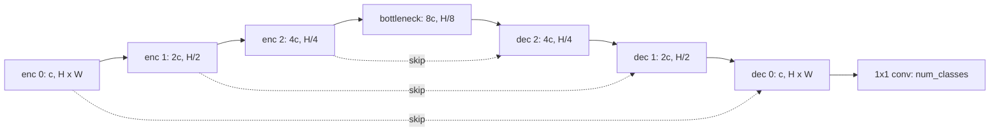

## Where this fits

Some questions need more than a box. How big is the tumour, which pixels are road, how many separate cells touch each other? Segmentation answers by labelling pixels. It reuses classification ([[vis.02]]) at a much finer grain, reuses the convolutional building blocks ([[seq.01]], [[vis.01]]) in a new layout, and for instance segmentation it adds a mask branch to the detector of [[vis.03]]. The overlap measures here (IoU and Dice) are the mask version of the box IoU you already know.

## The idea in plain words

Classification looks at the whole picture and answers with one label. To label every pixel the network needs two skills at once: seeing the context ("this is a street scene, so this grey region is probably road") and keeping precise detail ("the road ends exactly here"). A normal CNN gets context by shrinking the picture again and again, which throws the detail away.

**U-Net** solves this with a U-shaped design. The left side (the encoder) shrinks the image while looking for ever more abstract patterns. The right side (the decoder) grows it back to full size. Along the middle, bridges (**skip connections**) hand the sharp, high-resolution feature maps from the left side straight across to the matching level on the right side, so the decoder does not have to remember fine detail it never saw.

Three flavours of the task:

- **Semantic segmentation**: every pixel gets a class ("car", "road"). Two touching cars become one blob.
- **Instance segmentation**: every object gets its own mask and identity ("car 1", "car 2"), background "stuff" ignored.
- **Panoptic**: both: every pixel has a class and, for countable things, an instance id.

For instance segmentation the cleanest idea is: detect each object with a box ([[vis.03]]), then, inside each box, run a small network that predicts that object's mask.

## Semantic segmentation

### The U-Net shape

With input $H\times W$ and a base width of $c$ channels, depth $D$ means $D$ encoder stages. Stage $k$ ($k=0,\dots,D-1$) works at resolution $(H/2^k)\times(W/2^k)$ with $c\,2^k$ channels; pooling or strided convolution halves the resolution between stages. A bottleneck sits at $(H/2^D)\times(W/2^D)$ with $c\,2^D$ channels. The decoder mirrors the encoder: it upsamples by 2, **concatenates** the encoder feature map of the same resolution (the skip), and applies convolutions that bring the channel count back down. A final $1\times1$ convolution maps $c$ channels to the number of classes.



Since each stage halves the size, $H$ and $W$ must be divisible by $2^D$ (for $D=4$: by 16).

**Why skips.** By the bottleneck the spatial grid is tiny; the information about exactly where an edge lay was compressed away. Concatenating the encoder map at the same resolution restores it.

**Upsampling.** A transposed convolution learns the upsampling but can produce checkerboard artefacts if stride and kernel size do not divide evenly. Bilinear upsampling followed by a $3\times3$ convolution has fewer artefacts and parameters and is a common modern default.

**Resolution and memory.** Memory grows with $H\cdot W\cdot c_{\max}$. Large images are cut into overlapping tiles, or the bottleneck is replaced by dilated convolutions (the DeepLab family).

### Pixel-wise cross-entropy

The output is $(N,C,H,W)$ logits and the target is $(N,H,W)$ integer class ids. The loss is the classification cross-entropy of [[vis.02]] at every pixel, averaged:

$$
L_{\text{CE}}=-\frac{1}{NHW}\sum_{n,h,w}\log\operatorname{softmax}\big(z_{n,:,h,w}\big)_{y_{n,h,w}} .
$$

Its weakness is that every pixel counts equally. If 99% of pixels are background, predicting "background" everywhere gives 99% pixel accuracy and a useless model.

### Overlap measures: IoU and Dice

For a predicted binary mask $P$ and a ground-truth mask $Y$ (sets of pixels):

$$
\mathrm{IoU}=\frac{|P\cap Y|}{|P\cup Y|}=\frac{|P\cap Y|}{|P|+|Y|-|P\cap Y|},\qquad
\mathrm{Dice}=\frac{2|P\cap Y|}{|P|+|Y|} .
$$

**Relation between them.** Let $I=|P\cap Y|$ and $S=|P|+|Y|$. Then $\mathrm{Dice}=2I/S$ and $\mathrm{IoU}=I/(S-I)$. Solve the second for $I$: $I=\mathrm{IoU}\,(S-I)\Rightarrow I(1+\mathrm{IoU})=\mathrm{IoU}\,S\Rightarrow I/S=\mathrm{IoU}/(1+\mathrm{IoU})$. Substituting into Dice:

$$
\mathrm{Dice}=\frac{2\,\mathrm{IoU}}{1+\mathrm{IoU}} .
$$

The two are monotonically related, so they rank models identically; medical imaging reports Dice, driving benchmarks report IoU.

**Soft Dice loss.** To train with gradient descent, replace the hard mask $P$ by predicted probabilities $p\in[0,1]^{HW}$ (sigmoid for a binary class, softmax per class otherwise) and the sets by sums:

$$
\mathrm{Dice}(p,y)=\frac{2\sum_i p_iy_i}{\sum_i p_i+\sum_i y_i+\varepsilon},\qquad L_{\text{Dice}}=1-\mathrm{Dice}(p,y).
$$

The small $\varepsilon$ avoids $0/0$ on empty masks. Because the numerator and denominator are both sums over the whole image, a tiny foreground region counts as much as a large one: the loss is insensitive to how many background pixels there are. The usual training objective combines both losses, $L=L_{\text{CE}}+\lambda L_{\text{Dice}}$ with $\lambda\approx1$: cross-entropy gives stable gradients early, Dice sharpens the overlap late.

**Multi-class evaluation.** Build the confusion matrix $M$ over all pixels ($M_{ij}$ = pixels of true class $i$ predicted as $j$). Per-class IoU is $M_{cc}/(\sum_jM_{cj}+\sum_iM_{ic}-M_{cc})$ and **mean IoU** (mIoU) averages over classes. Report per-class IoU as well, since the mean hides a class stuck at 15% among nine at 85%. Boundary-based scores matter when thin contours are the goal.

## Instance segmentation: the Mask R-CNN idea

Mask R-CNN extends a two-stage detector (Faster R-CNN) with a mask branch:

1. A **backbone** (for example a ResNet) plus a **feature pyramid network** produce multi-scale feature maps.
2. A **region proposal network (RPN)** puts anchor boxes at every position, predicts "object or not" and a box correction for each, and keeps about a thousand proposals after NMS.
3. **RoIAlign** cuts a fixed-size feature patch (for example $7\times7$ or $14\times14$) out of the feature map for each proposal.
4. A **box head** classifies the patch and refines the box; a small convolutional **mask head** predicts one low-resolution binary mask per class (for example $28\times28$). Only the mask of the predicted class is used, which decouples mask prediction from classification. The mask is then resized to the box in image coordinates.

The total loss adds the RPN losses (objectness and box), the box head losses (cross-entropy over classes including background, and a smooth-L1 box regression) and a per-pixel binary cross-entropy for the mask.

### RoIAlign

A proposal's corners have real-valued coordinates in feature-map units, but the feature map is a grid. The older RoIPool **rounded** the box and each of its cells to integers; at a feature stride of 32 a rounding error of half a cell is 16 image pixels, which misaligns features and mask. **RoIAlign** keeps the real coordinates and reads each sample point by **bilinear interpolation**.

For a point $(y,x)$ with $y_0=\lfloor y\rfloor$, $x_0=\lfloor x\rfloor$, $w_y=y-y_0$, $w_x=x-x_0$, and feature map $f$:

$$
f(y,x)=(1-w_y)(1-w_x)f_{y_0,x_0}+(1-w_y)w_xf_{y_0,x_0+1}+w_y(1-w_x)f_{y_0+1,x_0}+w_yw_xf_{y_0+1,x_0+1}.
$$

This is two successive linear interpolations, one along $x$ and one along $y$. Check: if $f$ is linear, $f(y,x)=ay+bx+c$, bilinear interpolation reproduces it exactly, which is a handy test. To pool a box into an $m\times m$ output, divide it into $m\times m$ equal bins and sample at the bin centres (the real operator averages several sample points per bin). The source reports that replacing RoIPool by RoIAlign raised mask AP by roughly 3-4 points on COCO.

The torchvision implementation returns, per image, a dict with `boxes` $(K,4)$, `labels` $(K,)$, `scores` $(K,)$ and `masks` $(K,1,H,W)$ (threshold at 0.5 for a binary mask).

## Worked example

All numbers are reproduced by the exercise code.

**Dice and IoU of two $4\times4$ masks.** Ground truth has ones at $(0,1),(0,2),(1,1),(1,2)$ (a $2\times2$ block, $|Y|=4$). The prediction has ones at $(0,1),(0,2),(0,3),(1,1)$ ($|P|=4$). The overlap is $(0,1),(0,2),(1,1)$, so $|P\cap Y|=3$. Then $\mathrm{Dice}=2\cdot3/8=0.75$ and $\mathrm{IoU}=3/(4+4-3)=0.6$. Check the relation: $2\cdot0.6/1.6=0.75$. The Dice loss is $0.25$.

**Imbalance.** A $10\times10$ image with a single foreground pixel and an all-background prediction has pixel accuracy $0.99$ but Dice $0$.

**Mean IoU.** Predictions `[[0,0,1],[1,2,2]]` against targets `[[0,1,1],[1,2,0]]` give the confusion matrix (rows = true class)
`[[1,0,1],[1,2,0],[0,0,1]]`. Per-class IoU: class 0 $1/(2+2-1)=1/3$; class 1 $2/(3+2-2)=2/3$; class 2 $1/(1+2-1)=1/2$. mIoU $=0.5$.

**U-Net shapes.** Input $64\times64$, base 16 channels, depth 3: $(16,64,64)\to(32,32,32)\to(64,16,16)\to$ bottleneck $(128,8,8)\to(64,16,16)\to(32,32,32)\to(16,64,64)$. A $60\times64$ input would fail because 60 is not divisible by $2^3=8$.

**RoIAlign.** On the ramp feature map $f(y,x)=5y+x$ (a $5\times5$ array of $0..24$), $f(1.5,2.25)=9.75$. Pooling the box $(0.5,0.5,3.5,3.5)$ into $3\times3$ bins samples the centres $y,x\in\{1,2,3\}$ and returns $[[6,7,8],[11,12,13],[16,17,18]]$. For the box $(0.6,0.6,3.6,3.6)$ rounding the corners first (to $(1,1,4,4)$) moves every sample centre by $0.4$ in each axis; on this ramp the pooled values differ by more than $2$, a direct measure of the misalignment.

## Implementation

```python
import numpy as np

def dice_score(p, y, eps=1e-9):
    return 2 * np.sum(p * y) / (np.sum(p) + np.sum(y) + eps)

def iou_score(p, y, eps=1e-9):
    inter = np.sum(p * y)
    return inter / (np.sum(p) + np.sum(y) - inter + eps)

def confusion_matrix(pred, target, n_classes):
    cm = np.zeros((n_classes, n_classes), dtype=int)
    np.add.at(cm, (target.ravel(), pred.ravel()), 1)
    return cm

def bilinear_sample(feat, y, x):
    H, W = feat.shape
    y = min(max(y, 0.0), H - 1.0); x = min(max(x, 0.0), W - 1.0)
    y0, x0 = int(np.floor(y)), int(np.floor(x))
    y1, x1 = min(y0 + 1, H - 1), min(x0 + 1, W - 1)
    wy, wx = y - y0, x - x0
    return ((1-wy)*(1-wx)*feat[y0, x0] + (1-wy)*wx*feat[y0, x1]
            + wy*(1-wx)*feat[y1, x0] + wy*wx*feat[y1, x1])
```

In practice you use `segmentation_models_pytorch` or `monai` for U-Nets and their losses, `torchvision.models.detection.maskrcnn_resnet50_fpn_v2` for Mask R-CNN (fine-tuned by replacing the box and mask heads), and `torchvision.ops.roi_align` for the operator.

## Shapes

| object | shape |
|---|---|
| input | $(N,3,H,W)$ |
| logits | $(N,C,H,W)$ |
| semantic target | $(N,H,W)$ of integer ids |
| binary mask / probability map | $(N,1,H,W)$ or $(H,W)$ |
| confusion matrix | $(C,C)$ |
| RoI patch after RoIAlign | $(K,c,m,m)$ for $K$ proposals |
| Mask R-CNN mask output | $(K,1,H,W)$ after pasting back |

## Common misconceptions

- **"Pixel accuracy tells you the model is good."** Under imbalance it is almost meaningless; use per-class IoU or Dice.
- **"Dice and IoU disagree about which model is better."** They are monotonically related for a single mask; they can differ when averaged over images or classes.
- **"Skip connections add parameters for fun."** They carry the localisation detail the bottleneck lost.
- **"Instance segmentation needs per-pixel instance ids from the network."** Mask R-CNN predicts a fixed-size mask per detected box; the instance identity comes from the box.
- **"Rounding coordinates is harmless."** At large strides it shifts features by many image pixels, which is exactly what RoIAlign fixes.
- **"Resize masks like images."** Use nearest neighbour for masks or you create invalid class ids.

## Key takeaways

- Segmentation is classification per pixel; U-Net combines context (encoder) and detail (decoder with skips), and needs sizes divisible by $2^D$.
- Cross-entropy plus Dice handles class imbalance; $\mathrm{Dice}=2\,\mathrm{IoU}/(1+\mathrm{IoU})$.
- Evaluate with per-class IoU and mIoU computed from a confusion matrix.
- Mask R-CNN = detector + mask head on RoIAlign features; RoIAlign samples at exact positions by bilinear interpolation.

## Explain it yourself

1. Derive $\mathrm{Dice}=2\,\mathrm{IoU}/(1+\mathrm{IoU})$ from the set definitions.
2. Why does a 99%-background dataset break pixel-wise cross-entropy, and how does Dice avoid the problem?

## Further reading

- The two source lessons (U-Net and Mask R-CNN papers are cited there), plus DeepLab for dilated convolutions.
- [[vis.05]] for transformer encoders in segmentation, and [[vis.06]] for text-prompted open-vocabulary segmentation.

## Mastery criteria

You can lay out the shapes of a U-Net for a given input, compute Dice, IoU and mIoU from masks, state why the combined loss is used, and explain what RoIAlign does that RoIPool does not, including the bilinear formula.
